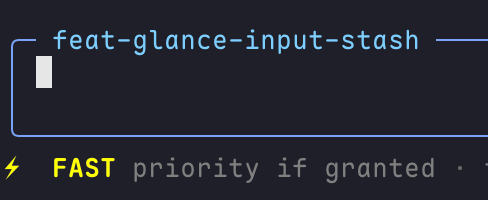

# pi-fast-mode

[English](./README.md)

`pi-fast-mode` 会向**同一个模型**请求更高的调度优先级。它不是更快的模型变体，也不是 thinking-level 控制。

## 功能

- 用 `/fast` 或 `Ctrl+F` 开关 Fast / Priority。
- 每个模型的当前开关只存在内存里，不会写入 session jsonl。
- 用 `/fast default on|off` 设置**当前模型**下次进程的默认值。当前这次会话的开关也会跟着改。
- 没配过的模型默认关闭。没有「所有模型」默认。
- 在支持的模型上显示 footer 状态。不支持的模型隐藏状态，并且不改请求。

需要 Pi 1.2 或更高。Fast 只作用于当前 Pi 主会话中的正常 Agent 请求，不覆盖 Consult、Recap 等扩展直接发起的 SDK 调用。请求钩子、采样和输出预算继续由 Pi 控制；Fast 不改变模型、认证、endpoint 或价格配置。

## 安装

```bash
pi install npm:@zhcsyncer/pi-fast-mode
# 或通过根 bundle
pi install npm:@zhcsyncer/pi-extensions
# 本地
pi -e ./packages/pi-fast-mode
```

根 Git bundle 也包含这个扩展：

```bash
pi install git:github.com/zhcsyncer/pi-extensions
```

## 命令

```text
/fast
/fast on
/fast off
```

切换或设置**当前**内存开关。`Ctrl+F` 是同一个开关，带短时防抖，按住键不会连续翻转，松开也不会再切换。

```text
/fast default on
/fast default off
```

写入当前模型的下次默认，并且当前这次会话的开关跟着改。当前模型不支持 Fast 时命令失败。

没有 `/fast status` 命令，也没有 `gpt-fast-mode` 兼容别名。

## 设置

默认值是 Pi `settings.json` 里一份 `provider/id` 名单。只有写进列表的模型会默认开启：

```json
{
  "fast-mode": {
    "models": ["openai/gpt-5.6"]
  }
}
```

`/fast default` 是修改该列表的官方方式。手动编辑会在 `/reload` 或进程重启后生效。旧的 `fast-mode.enabled` 布尔值或 `{ "provider/id": true }` 映射会在启动或 `/reload` 时改写。以前的全局开不会变成所有模型都开；发生这种迁移时，Fast Mode 会在聊天里给出警告。

## 状态栏



- 支持的模型，开启：`⚡ FAST`
- 支持的模型，关闭：暗色 `fast`
- 不支持的模型：隐藏状态，并且不改请求
- `/fast` 和 `Ctrl+F` 只更新底栏。它们不会往聊天记录里加提示。

## 支持的提供商

提供商列表是固定的，没有用户白名单。

- OpenAI 和 Codex 在 Fast Mode 开启时请求 `priority`。
- Pi 内置 xAI 模型已全部使用 Responses，并在 Fast Mode 开启时请求 `priority`。
- `models.json` 里的自定义 xAI Completions 模型仍受支持。

不支持的模型隐藏底栏状态，并且不改请求。关闭 Fast 只停止覆盖 `service_tier`，不会删除用户配置原本提供的 tier。Fast 不会写入 `models.json`。

## 价格与计费

不要假设每个模型都会被授予 priority。

- OpenAI Fast / priority 官方定价面向 GPT-5.6 系列。更旧的模型可能拒绝或忽略该请求。
- Fast 请求 `priority`，但不调整 Pi 的本地费用估算。估算可能与提供商实际收取的 priority 费用不同，以提供商账单为准。
- 自定义 xAI Completions 模型也一样。Fast 底栏标记表示请求的模式，不代表已获该优先级或确认价格。

## Session 生命周期

- `/fast` 和 `Ctrl+F` 只改当前模型的内存开关。
- 换模型跟该模型自己的开关。第一次用到时读它的下次默认；没配过就是关。
- 同一 Pi 进程里的 `/new`、`/resume`、`/fork` 会保留各模型当前开关。
- `/reload` 或进程重启会从 `settings.json` 重新读取按模型默认。
- `/fast default on|off` 写当前模型的设置默认，并且当前这次会话的开关跟着改。
