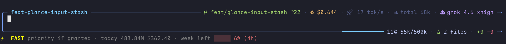
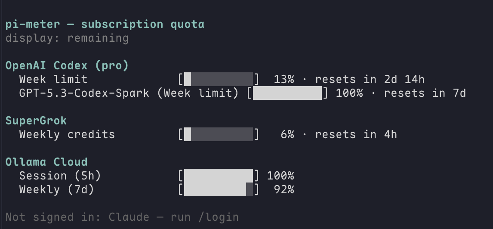

# @zhcsyncer/pi-meter

[简体中文](./README.zh-CN.md)

Usage meter for the [Pi coding agent](https://pi.dev). One `/usage` command answers two questions: how much of a subscription window is left, and where local tokens and cost went.

This package is also included in `@zhcsyncer/pi-extensions`.

## Sources

This package combines two existing Pi extensions:

| Source | What you already know | What this package changes |
|---|---|---|
| [`pi-tracker`](https://github.com/alpertarhan/pi-tracker) | Local token/cost ledger, dashboard, budgets, session import | Those live under `/usage`, not `/analytics`. Counts use `34k` / `4.3M` / `5.35B`. |
| [`@pi-plugins/usage`](https://github.com/k3dom/pi-plugins/tree/main/plugins/usage) | Claude and Codex subscription windows | Those live under `/usage quota`. SuperGrok and Ollama Cloud are included. |

Do **not** load `@pi-plugins/usage` at the same time. Both register `/usage`. If both are present, this package warns once and continues.

`pi-tracker` can stay loaded for comparison, but this package owns `/usage`.

## Features

- Footer line for the last 24 hours of local spend next to the current model's subscription window:

  ```text
  · 24h 12.4k $0.18 · xai week left ███░░ 49% (1d 23h)
  ```

  

- Recorded-usage dashboard by model, project, or session, including cache write. Counts finalized assistant messages, outer tool usage, standalone usage (including new operation kinds), and reported compaction / branch-summary usage. Consult fanout remains attributed to its advisors. Nested tool usage is not added twice; unknown or partial costs are marked rather than presented as confirmed zero.
- Claude, Codex, SuperGrok, and Ollama Cloud remaining after `/login` for that provider. Codex also shows banked weekly resets when you have any; the footer adds `N resets …` only while the current model is Codex.
- `/usage quota` opens a temporary dashboard. Unsigned-in providers stay as a muted summary at the bottom. If the current model has no window, or that provider is unsigned / unavailable, the footer shows a short hint instead of another vendor's bar. Snapshot titles show their age (`12m ago`) instead of the word stale.
- Other extensions can register a quota source. The footer still follows the current model only.
- Optional local budgets. They warn; they never block requests.
- `/usage import` backfills saved sessions. Pi 1.1 entries are counted once across live capture, imports, renamed copies, and reloads. Existing ledger rows are retained; older identity compatibility does not promise to repair every historical duplicate or missing charge.

  

`--no-session` still records local usage. Sub-agent usage is counted from each child's messages, not parent `Agent` results or marked `get_subagent_result` rollups; Pi's native session totals are unchanged. For reliable real-time coverage, including isolated children, add `"pinnedExtensions": ["pi-meter"]` to the user-level `$PI_CODING_AGENT_DIR/extension-data/pi-subagents/config.json`. Without pi-meter loaded in the child, use `/usage import` for saved child sessions. Missing child logs can leave coverage incomplete; finding some child usage does not establish complete coverage. The ledger shows recorded consumption, not an exact bill or subscription balance. Idle usage becomes visible at the next lifecycle boundary or `/usage` command.

## Install

Standalone:

```bash
pi install npm:@zhcsyncer/pi-meter
```

Or install the whole extension bundle:

```bash
pi install npm:@zhcsyncer/pi-extensions
```

Try without installing:

```bash
pi -e npm:@zhcsyncer/pi-meter
```

Then restart Pi or run `/reload`. If `@pi-plugins/usage` is already in `settings.json`, remove it.

## Commands

| Command | What you see |
|---|---|
| `/usage` | Menu: dashboard, quota, footer, budgets, import |
| `/usage quota` | Open the remaining/reset-time dashboard for Claude, Codex, SuperGrok, and Ollama Cloud |
| `/usage quota refresh` | Refresh subscription windows and open the dashboard |
| `/usage footer` | Configure the local summary, rolling/calendar window, quota visibility, and used/remaining display |
| `/usage import` | Back-fill from session files with an explicit added/duplicate/skipped/unchanged summary |
| `/usage budget` | View or add a local budget |

## License

MIT

Local-ledger ideas come from MIT-licensed [`pi-tracker`](https://github.com/alpertarhan/pi-tracker). Subscription-window ideas come from MIT-licensed [`@pi-plugins/usage`](https://github.com/k3dom/pi-plugins/tree/main/plugins/usage).
