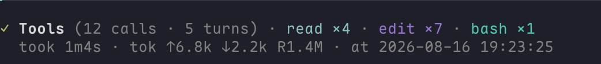
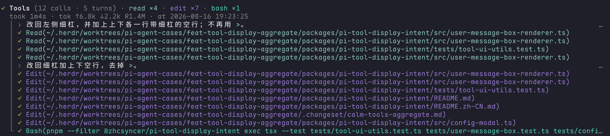

# pi-tool-display-intent

[English](./README.md)



`pi-tool-display-intent` 是 [`MasuRii/pi-tool-display`](https://github.com/MasuRii/pi-tool-display) 0.5.0 的维护 fork，保留紧凑工具展示，并加上模型写的用户可读意图。`displaySummary` 改编自 [`mertdeveci5/pi-tool-display-summary`](https://github.com/mertdeveci5/pi-tool-display-summary) 0.1.0。

```text
read docs/tax-code.pdf — 检查 Colorado 税法
$ pnpm test — 验证 extension 测试套件

● Read(docs/tax-code.pdf) — 检查 Colorado 税法
  ⎿ loaded 42 lines
```

当前模型在正常 tool call 里写 `displaySummary`。这个扩展**不会**再发起一次推理，也不需要第二个模型或额外 API Key。

## 功能

- 只有 Bash 会向当前模型要 `displaySummary` 意图。普通调用或 codemode 脚本省略时会补上 fallback，其它非法参数仍会被校验拒绝；其它内置工具保留原 schema。
- 内置、自定义、晚连接的 MCP 工具及已保存的工具历史使用统一行样式，同时保留工具原有的专用内容。
- Claude 风格：状态标记、`Name(target)`、缩进结果。
- 已完成文本工具历史重绘更快，进行中的输出仍持续更新。
- 可选 `aggregate`：一次用户请求收成一条 **Run** 账本，默认也收纳 Agent 和 consult。
- Fullscreen 鼠标交互：点击收起的 Run 内容区展开本账本，点击展开后的摘要区收起；工具行可查看结果，不重新执行工具。
- 可选上下文增长汇总与逐拍标记，帮助定位占用上下文较多的步骤。
- 调用行只显示简短参数值，不展示 key；失败详情缩进，完整键值参数通过点击查看。
- 保留上游的 compact / summary / preview 结果模式。
- 提供合作式 API，其它工具仍可自行选择同一意图字段。

不要同时加载 `pi-tool-display`、`pi-tool-display-summary` 和本扩展。它们会注册同名内置工具。

## 安装

需要 **Pi 1.1 或更新版本**。普通直接调用仍是完整支持的使用方式；安装不会开启 codemode 或连接 MCP 服务。自行启用 codemode 后，其 JavaScript 输入和工具结构化结果保持不变。

```bash
pi install npm:@zhcsyncer/pi-tool-display-intent
pi install npm:@zhcsyncer/pi-extensions
```

然后重启 Pi 或执行 `/reload`。

## 使用

```text
/tools
/tools aggregate
/tools individual
```

空的 `/tools` 打开设置面板。切布局会先确认再保存并 reload。两种布局都能配置 bash intent 语言，修改后经 `/reload` 生效；其它展示旋钮按布局显示。在面板中修改预览行数或结果模式，也会刷新已有历史行。

超大的预览、diff 和详情可能显示明确的展示省略提示，即使关闭展开行数限制也一样。这些保护不改变执行结果、模型输入或 usage。被省略的 diff 不会冒充完整对比；只有工具提供真实产物时才会显示全文链接。

## 布局

`individual` 是默认：每个工具各占一行。Write 行可以对比本次写入前捕获的原内容与提供的新内容，即使文件随后再次变化也不会混淆。历史行不会重新读取当前文件来猜测旧版本。

脚本或工具内部调用其他工具时，仍只占一条顶层记录。原生 codemode 保留脚本、进度和输出；已记录的后代操作放在根调用下面，不重复原生已展示的直接调用。Aggregate 只计根调用一次，不把子操作或模型调用加进顶层工具数。根调用成功时，子操作仍可能失败、取消或未结束。

嵌套展示最多保留 256 次调用，参数限制为每次 8 KiB、累计 32 KiB（compact JSON 的 UTF-8 字节）。原生参数片段仍是预览，不冒充完整参数。部分列表及仅覆盖可见项的费用会明确标注，嵌套行不重复计入 usage。历史缺少参数、父关系、耗时或子结果正文时保持“不可用”，不会重新执行工具补全。

`aggregate` 把一次用户请求里所有已注册内置、custom、MCP 和延迟加载工具收进一条 Run：





```text
● Run (37 calls · 3 turns) · read ×12 · ask_user_question ×1 · edit ×8 · bash ×16
  › 先对照两边入口
  ● Bash — 把策略固化成 zone · 54 lines · 2.3KB           12s

● Run (38 calls · 3 turns) · read ×12 · ask_user_question ×1 · edit ×8 · bash ×17
  ↳ 2 steers
  took 2m14s · tok ↑62k ↓8.4k R120k W4.1k · at 2026-04-08 14:32:14
```

进行中时，最新一条 assistant 旁白按 Markdown 停在标题下，最多三行。每条可见调用把耗时靠右放在首行，目标过长时最多再占一行。结束后旁白收起，mute 收据显示耗时、token、cache 和本地时间。收起时失败只显示 `N failed`。中途 steer 仍是同一本 Run：进行中钉各条首行，结束后留一行 `↳ N steers`。`Ctrl+O` 展开原时间线，每条 `↳` 留在当时的位置，每条调用最多 8 行；失败详情另起缩进行。默认 `flat` 仍是逐条带时间；把 `toolCalls.expandedTimeline` 调成 `turns` 后，按拍显示 `↻ 1/3 · 3 calls` 拍头，调用行缩进，不用 reload。多行 bash 只显示 intent 和体积，不倒脚本。Agent 和 consult 使用同样的紧凑调用行。图片 read 像其它 output 一样收进 Run 账本。切回：`/tools individual`。

用户行默认使用左侧强调色细杠。两种布局都可打开 `/tools`，输入 `native` 找到 **User message box**，按 Space/Enter 关闭自绘，改用原生／下游用户消息渲染。修改立即作用于已有和新消息，且在 `/reload` 后保留；aggregate steer 的折叠和分组不受影响。自绘消息保留 Pi 的消息导航边界。

### Agent 与 consult

两者默认进入聚合账本。Agent 行只保留类型和任务描述，不铺开 prompt 或控制开关：

```text
↗ Agent(Explore · 检查账本交互) · dispatched
✓ Agent(Plan · 审查方案)
✓ consult(评估聚合兼容性)
```

`dispatched` 只表示后台调用已派发，**不代表子任务完成**，旁边的计时也是本次调用耗时。确认完成的前台调用使用 `✓`，排队和预约回执另作标记。原有 subagent widget 和 `/agents` 仍用于查看实时任务与历史。点击账本行打开通用 Result / Args，不会直接打开 subagent 专用 viewer。

可见的 custom message（包括子任务完成通知）现在按原有 transcript 顺序一起收进 Run；展开后保留原 renderer 和原生按钮。最终回答之后到达的通知另起一段，不搬回之前派发任务的 Run。纯消息段显示 `Run (N messages)`，消息不计为工具调用。隐藏消息仍然隐藏，widget 和仅供 UI 使用的 custom entry 仍独立展示。`tools.passthrough` 控制工具调用，不控制这些消息。

已有显式 passthrough 名单不会被自动删除。这些工具保留原生内容、展开方式和交互，但统一对齐账本的内容缩进，不再贴着终端左边缘。如果原配置仍将 Agent 或 consult 留在账本外，将 `tools.passthrough` 设为 `[]` 后 `/reload` 即可。

### 点击查看详情

在 Pi **1.1+ fullscreen 模式**下，点击**收起的 Run 内容区**任意位置（包括统计收据、当前调用预览）即可只展开这一本 run 账本。展开后，整个标题／统计摘要区都可点击收起。上下空白间距和展开后的旁白正文不触发开合，拖动仍用于选择文本。`Ctrl+O` 仍切换整个会话，并覆盖局部选择。透传工具保留自己的原生交互。

展开时会保留聚合标题在视口中的位置，不再追随新增内容跳到末尾。向下阅读较长的展开账本、标题滚出视口上方后，输入框上方的 widget 组顶部会出现固定的 **`↑ Run (…) · Collapse`** 收起条，靠右显示。点击只收起当前账本，并回到它的聚合标题；不会抢输入焦点或覆盖正文。这些视口功能需要兼容的 Pi 1.1+ fullscreen 渲染器，普通终端滚动模式不提供账本鼠标交互。

点击展开后的工具行，打开只读 **Result / Args** 查看器。Result 会排版 JSON、从 `.md` / `.markdown` / `.mdx` 路径读取的 Markdown 文件，以及明确的自定义工具 Markdown；其他源码和日志保持原文。Args 使用键值行和多行文本块，Bash command 会做 Shell 语法高亮。额外的 **Metadata** 收在 `⋯` / `M` 后，不参与主标签的 Tab 循环。`Raw` / `R` 查看文本或 JSON 原文。弹窗不再对凭据脱敏，但仍过滤终端控制字符并保留明确的体积限制，分享前请核查内容。长文本自动换行，调整窗口尺寸后也会重排。用 `Tab` 切换 Result/Args，方向键／Page Up／Page Down 或滚轮滚动，`Esc` 返回。工具本身已截断的输出无法恢复。

成功的 Edit 调用若返回了 diff，**Result 就是 diff**，不另设标签。成功的 Write 也使用同一视图，把写入内容标为新增，并明确说明这不是覆盖前后的净差异。Write 固定单栏；Edit 跟随全局 **Diff layout** 和 `diff.splitMinWidth`。两者仍共用 **Diff indicators** 和 `diff.wordWrap` 配置；aggregate 的 `/tools` 中也能配置布局与标记。Raw 保留原始返回及源内容；失败或缺少必要数据时显示普通结果，不根据当前文件猜测历史改动。

账本只有在完整目标能放进一行时才显示 `Bash(command)`。超长或多行命令只显示 Bash、intent 和体积；点击展开后的调用查看完整参数。

展开的 steer 按终端宽度换行：不超过 8 行内容时完整显示，超过后保留头 3 行、尾 2 行，中间显示 `… N lines hidden · click to view`。点击省略行查看原始消息。收起态仍每条一行。

### 上下文增长

在 aggregate 下打开 `/tools`，将 **Context growth** 设为 on（默认 off）。收据显示整个 run 的净增长；把 **Expanded timeline** 设为 **turns**，可查看各拍贡献：

```text
took 18s · ctx ≈+3.2k · tok ↑… ↓…
↻ 1/2 · 2 calls · ctx +2.4k
```

下一次请求完成后，输入差值回填到**上一拍**。末拍或尚未确认的拍使用本地估算，标记 `≈`；总计含估算时也保留 `≈`。没有工具调用的普通回复不追加 ctx 尾注；最终模型用量仍计入 Run 总计。有工具调用的透传拍可以使用轻量尾注。`flat` 只显示 run 总计。开关修改不用 reload。

`ctx` 表示上下文增长，不是累计 token 消耗（`tok`），也不代表逐工具的独立成本。报告差值也可能包含提示词或供应商转换带来的变化。缺少数据，或遇到 steer、压缩、换模型等已知上下文边界时，run 总计显示 `ctx n/a`，不拼出误导性数字。

## 设置

打开 `/tools`，或看 [`config/config.example.json`](./config/config.example.json)。

| 改什么 | 效果 |
|---|---|
| `toolCalls.layout` | `individual` 或 `aggregate` |
| `toolCalls.expandedTimeline` | `flat` 展开逐条，或 `turns` 按 agent turn 分组（仅 aggregate，不用 reload） |
| `toolCalls.showContextGrowth` | 显示 `ctx` run 总计与逐拍标记；默认 `false`（仅 aggregate，不用 reload） |
| `transcript.userMessageBox` | 普通用户消息自绘开关，默认 `true`；`false` 使用原生／下游渲染，不影响 steer |
| `results.mode` | `compact`、`summary` 或 `preview` |
| `intent.language` | bash intent 语言：尽量跟随请求、固定简体中文或固定英文（经 `/reload` 生效） |
| `diff.layout` / `diff.indicators` | Edit 的 diff 布局及 Edit/Write 共用的标记；Write 固定单栏 |
| `diff.collapsedMode` | `body` 预览，或只要 `summary` 统计（individual 工具行） |
| `tools.passthrough` | 显式保留原 renderer 的工具，默认 `[]` |

旧的 `toolCalls.style` 和 `transcript.userMessageStyle` 会被丢掉。

## 自定义工具

aggregate 下，没有 call-presentation adapter 的 generic custom tool 最多显示两个有辨识度的值，不展示键名，例如 `web_search(prod metrics)`、`todo(审查迁移方案)`。prompt、载荷、控制开关和疑似凭据不进入行内预览；完整键值请打开 Args 查看。工具自己提供的 `getCallPresentation` 始终优先，individual 模式保留原有参数预览。

自定义 renderer 保留原有的专用调用／结果内容。逐工具输出设置控制通用 fallback 内容；若要完全保留某个工具的原展示，使用 `tools.passthrough`。

只有希望该工具主动加入同一意图字段时，才在 `pi.registerTool` **之前**包装。`overrideExistingRenderers: true` 表示明确允许替换它的 renderer：

```ts
import {
  decorateToolForDisplay,
  withDisplaySummary,
} from "@zhcsyncer/pi-tool-display-intent/tool-display-api-consumer";
import { Type } from "typebox";

const tool = withDisplaySummary({
  name: "web_search",
  label: "Web Search",
  description: "Search the web.",
  parameters: Type.Object({
    query: Type.String()
  }),
  async execute(_toolCallId: string, args: { query: string }) {
    return runSearch(args.query);
  }
}, {
  language: "auto",
  required: true
});

pi.registerTool(decorateToolForDisplay(tool, {
  kind: "generic",
  outputMode: "inherit",
  overrideExistingRenderers: true
}));
```

## 许可证

MIT。见 [`LICENSE`](./LICENSE) 与 [`UPSTREAM_LICENSE`](./UPSTREAM_LICENSE)。
